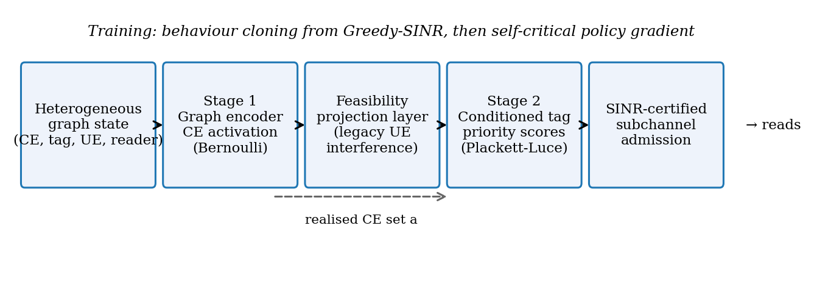
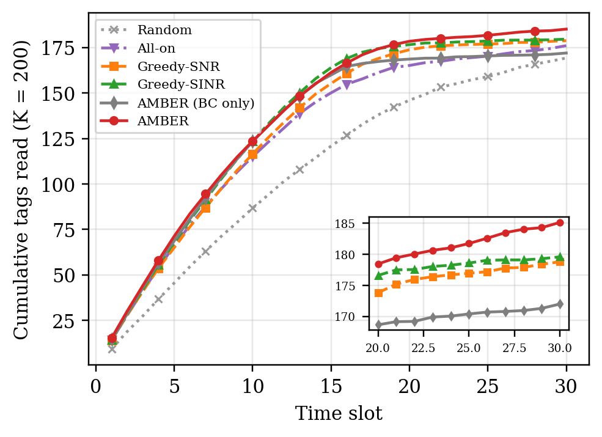

# AMBER: Ambient IoT Carrier Scheduling and Backscatter Device Grouping for 6G

Official implementation of

> G. Arul Dalton, "Joint Carrier Scheduling and Backscatter Device Grouping for Ambient IoT in 6G Networks via Feasibility Guaranteed Reinforcement Learning," submitted to *IEEE Internet of Things Journal*, 2026.

In 3GPP Ambient IoT, battery-free tags harvest energy from carrier waves sent by separate **carrier emitters (CEs)** and answer by backscattering to **readers**. In every slot the network must decide which CEs to switch on and which tags to group onto which backscatter subchannel, while never exceeding the interference limit of nearby **legacy 5G/6G users**.

**AMBER** solves this with:
1. a learned CE-activation policy (heterogeneous graph encoder),
2. a **feasibility projection layer** that guarantees the legacy interference limit in every slot (Proposition 1),
3. conditioned tag scoring with a **Plackett–Luce** ranking model,
4. an **SINR-certified** subchannel admission decoder,
5. two-phase training: behaviour cloning from a greedy teacher, then **self-critical policy gradient**.

<p align="center"></p>

## Results (K = 200 tags, 30 slots)

| Scheme | Tags read @10 | @20 | @30 | Interference violations |
|---|---|---|---|---|
| Greedy-SNR | 116.5 | 173.8 | 178.8 | 0% |
| Greedy-SINR | 123.6 | 176.6 | 179.6 | 0% |
| **AMBER** | **123.6** | **178.4** | **185.2** | **0%** |
| AMBER without projection layer | – | – | 188.6 | **93% of slots** |

Paired over 30 unseen layouts: **+5.9 ± 1.7 tags** vs Greedy-SINR (p = 1.4 × 10⁻⁷).

<p align="center"></p>

## Installation

Python 3.9+ and a CPU are enough (no GPU).
```bash
git clone https://github.com/iitrky/AMBER.git
cd AMBER
pip install -r requirements.txt
```

## Quick start
```bash
python examples/quickstart.py      # one inventory round, AMBER vs Greedy-SINR
python tests/test_core.py          # correctness tests (or: python -m pytest tests)
```

## Reproduce the paper
```bash
bash scripts/reproduce_all.sh      # all tables and figures from the trained models (~30-45 min)
bash scripts/train_all.sh          # optional: retrain everything from scratch (~45 min)
```

## Repository structure
```
AMBER/
├── src/
│   ├── env.py          # Ambient IoT simulator: channel, harvesting, SINR, legacy constraint, projection layer
│   ├── baselines.py    # Random, All-on, Greedy-SNR, Greedy-SINR, capacity bound
│   ├── amber.py        # AMBER policy: graph encoder, two stages, Plackett–Luce ranking, Adam
│   ├── hybrid.py       # SINR-certified admission decoder (inference)
│   ├── bc.py           # Phase A: behaviour cloning
│   ├── train.py        # Phase B: self-critical policy gradient
│   ├── exp.py          # Experiments E1–E4
│   ├── paired.py       # Paired significance test
│   └── figs.py         # All paper figures
├── models/             # Trained checkpoints (full model and ablations)
├── results/            # Raw JSON results behind every table and figure
├── figures/            # Paper figures
├── scripts/            # reproduce_all.sh, train_all.sh
├── examples/           # quickstart.py
├── tests/              # test_core.py
├── docs/IMPLEMENTATION.md   # paper-to-code map, hyper-parameters, experiment protocol
├── data/               # generated imitation dataset (not tracked)
├── requirements.txt  CITATION.cff  LICENSE
```
See **[docs/IMPLEMENTATION.md](docs/IMPLEMENTATION.md)** for a line-by-line mapping from the paper's equations and algorithms to the code.

## Key parameters
16 carrier emitters, 4 readers, 8 mobile legacy UEs, 100–800 tags; 900 MHz, 3GPP TR 38.901 InF-SL; CE power 30 dBm; tag sensitivity −20 dBm; 4 subchannels × 15 kHz per reader; SINR threshold 3 dB; legacy interference limit −62 dBm.

## Limitations
Gains appear in the late inventory phase; the prototype is slower than greedy heuristics; performance drops for interference limits much stricter than in training; graph message passing did not add measurable benefit at these scales. See Section VII of the paper.

## Citation
```bibtex
@article{aruldalton2026amber,
  author  = {Arul Dalton, G.},
  title   = {Joint Carrier Scheduling and Backscatter Device Grouping for Ambient {IoT} in {6G} Networks via Feasibility Guaranteed Reinforcement Learning},
  journal = {IEEE Internet of Things Journal},
  note    = {submitted},
  year    = {2026}
}
```

## Contact
Dr. G. Arul Dalton, Department of Computer Science and Engineering, Saveetha Engineering College, Chennai, India
aruldalton@saveetha.ac.in · ORCID 0000-0002-5981-7176

## License
MIT (see `LICENSE`).
